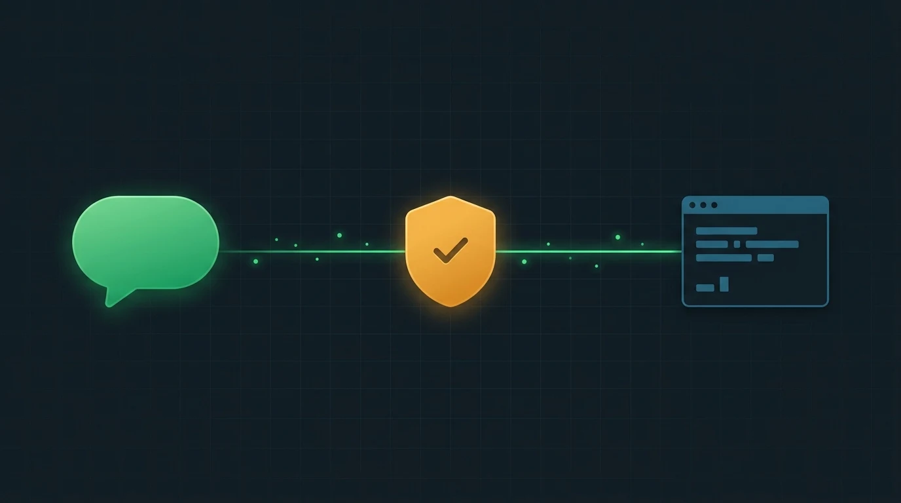

# WhatsApp for AI agents

**English** | [Português](README.pt-BR.md)



Connects your WhatsApp to AI agents through an MCP server. It works with Claude Code, OpenBot, Codex, OpenCode, OpenClaw and any other agent that speaks MCP. The agent reads and searches conversations, transcribes voice notes and suggests replies in your own writing style. **Sending is off by default and nothing goes out without your explicit confirmation**: the server starts in read-only mode, and if you turn sending on, every message needs your confirmation.

| Your agent | How to use it | What comes with it |
|---|---|---|
| **Claude Code** | plugin | skills, commands, a hook that starts the bridge, and the send guard |
| **OpenBot** | MCP server in containers ([guide](docs/openbot.md)) | skills; the bridge stays out of the agent's reach |
| **Codex, OpenCode, OpenClaw** | MCP server over stdio ([guide](docs/agentes.md)) | skills |
| **Any other agent with MCP** | MCP server over stdio or HTTP | skills |

The project includes everything you need:

- **MCP server** in Python with 13 tools (search contacts, read messages, send, download media, transcribe audio).
- **Bridge** in Go that connects to WhatsApp as one more linked device (multi-device).
- **Six skills**, in the standard skill format, for any agent that accepts them: one that **installs and configures everything for you** (see the section below) and five that teach the agent to use the MCP, triage conversations, remember how you talk to each contact, write like a human and split replies into several messages.
- **Commands** for Claude Code (`/whatsapp:status`, `/whatsapp:pendentes`, `/whatsapp:responder`, `/whatsapp:resumo`, `/whatsapp:loop`, `/whatsapp:modo`). In other agents, ask in plain language.
- **Claude Code hooks**: one starts the bridge when the session begins, the other is the send guard. In other agents, the MCP server provides this protection by itself (see "Send modes").

> **Read before using.** The bridge uses the `whatsmeow` library, an **unofficial** WhatsApp client. Using it may go against WhatsApp's terms and your number may be banned. Use it at your own risk, with your own number, and respect the privacy of the people you talk to. This project is not affiliated with WhatsApp or Meta.

## Install with an agent's help

The shortest way: paste this text into your agent (Claude Code, OpenBot, Codex, OpenCode, OpenClaw or any other agent with a terminal).

```
Install the WhatsApp plugin for me. Clone https://github.com/armandonettox/whatsapp-plugin, read the file skills/instalar-whatsapp/SKILL.md and follow it until the server works. Ask before installing any program, stop when I need to scan the QR code on my phone, keep message sending turned off and never show the bridge password.
```


The agent follows the [`instalar-whatsapp`](skills/instalar-whatsapp/SKILL.md) skill: it detects your system and which agent it is running in, asks every choice in a single message, installs what is missing (with your permission), downloads the ready-made bridge (or builds it), registers the MCP server, checks that everything works and hands you a summary. After every step it runs a diagnostic (`skills/instalar-whatsapp/scripts/verificar_instalacao.py`) that only reads and tells you what is still missing. The skill itself is written in Portuguese, which the agent reads without trouble.

**What stays with you:**

- **Scanning the QR code on your phone** (WhatsApp, Linked devices): only you can do it.
- **Authorizing** program installs (uv, Go, a C compiler, Podman).
- **Deciding** whether the agent may send messages. The install ends with sending off (`read-only`).

**What it will not do:** send a message (not even a test one), show the bridge password, or touch services that are already running without asking you first.

Prefer to install by hand? See "Manual installation" below.

## How it works


1. The agent calls a tool on the **MCP server**.
2. To **read**, the server queries the local SQLite databases (`data/store`) directly, which the bridge keeps up to date.
3. To **send** or download media, the server calls the **bridge** over HTTP, only inside your computer (`127.0.0.1:8081`).
4. The bridge talks to WhatsApp over the multi-device protocol and stores everything that comes in and goes out in the databases.
5. Before any send, the **guard** checks your last message (see below).

## The send guard (Claude Code)


The guard is a Claude Code hook that runs before `send_message`, `send_file` and `send_audio_message`. It reads **your last message** in the conversation and only allows the send if it is a short, direct confirmation. It understands Portuguese, English and Spanish.

| Allows | Blocks |
|---|---|
| yes, send it, go ahead, sounds good, "sim, manda", "dale" | no, but, change, wait, any question, long sentences |
| | "yes, but change the hi" (a confirmation with an edit) |

When it blocks, the agent shows the exact text and the recipient and asks for confirmation again. The guard **fails closed**: if it cannot check (no conversation history, or no Python), it blocks the send.

**Important limit:** the guard is a Claude Code feature. In other agents (OpenBot, OpenClaw, Codex, OpenCode and similar) it **does not exist**, but the server protects itself: by default it is **read-only** and the send tools do not even appear to the agent. See the [send modes](#send-modes).

## Send modes


The `WHATSAPP_SEND_MODE` variable decides what the MCP server allows. Without it, the safest mode applies.

| Mode | What happens | When to use it |
|---|---|---|
| `read-only` (default) | The send tools **do not even appear** to the agent. It can only read, search, download media and transcribe. | Any agent, with no setup. |
| `two-step` | The send tools only **save a draft**. You send it, in the terminal, with `confirm.py`. | OpenBot, OpenClaw, Codex, OpenCode and other agents without the guard. |
| `hook` | The tools **send directly**. | Claude Code only, where the guard confirms every send. The plugin turns this mode on by itself. |

An unknown, misspelled or empty value falls back to `read-only`.

### How `two-step` works

1. The agent calls `send_message`. Nothing is sent: the server saves a draft and returns an identifier and the command for you.
2. The agent shows you the text and the recipient and asks you to run the command.
3. You open **a terminal of your own**, in the `server/` folder, and review the draft:

```
python confirm.py list             # drafts waiting
python confirm.py show a1b2c3d4    # full text and recipient
python confirm.py send a1b2c3d4    # asks, and only sends if you type "enviar"
python confirm.py discard a1b2c3d4
```

4. The agent can ask for the result with `check_pending_send` (`pending`, `sent`, `discarded` or `expired`). It never gets the text back.

`confirm.py send` refuses to run without an interactive terminal and has no option to skip the question. Drafts expire after 30 minutes and at most 20 can wait at the same time. Several parts of one reply can be sent with a single confirmation, as long as they go to the same recipient.

**Honest limit:** an agent that has a terminal of its own and knows how to simulate a keyboard could, in theory, run `confirm.py` by itself. If your agent has a shell tool, keep `read-only` or use the agent's permissions to block commands that call `confirm.py`.

### Agents with a terminal (OpenBot): isolation with containers


An agent that has a terminal and runs without asking could call the bridge API directly and ignore the send modes. That is why, for OpenBot and similar agents, the bridge and the MCP server run in containers: the bridge sits on a network the agent cannot reach, its API requires a password that only the two containers know, and the agent only reaches the MCP server. The step-by-step, on a VPS or on your computer, is in [docs/openbot.md](docs/openbot.md).

## Privacy and security

- Messages and databases stay on your computer. **What the agent reads is sent to the model you use** (your agent's provider). Do not use it with conversations that cannot go through it.
- The bridge API listens only on `127.0.0.1` by default and **can send messages from your number**. It accepts a password (`WHATSAPP_BRIDGE_TOKEN`), which is mandatory in containers. An agent with a terminal on the same computer can reach that port: for that case, use the container isolation.
- The `data/` folder holds the messages and the WhatsApp session. Whoever reads that folder controls your account. It is in `.gitignore`: never send it to git, the cloud or a shared backup.
- Per-contact notes (`data/notas`) and loop drafts (`data/rascunhos`) are other people's personal data and also stay out of git.

## Requirements

| Item | What for |
|---|---|
| An agent with MCP support | Claude Code, OpenBot, Codex, OpenCode, OpenClaw or another |
| [`uv`](https://docs.astral.sh/uv/) | runs the MCP server |
| [Go](https://go.dev/dl/) 1.25 or newer and a C compiler (`gcc`) | only if you build the bridge yourself (it uses SQLite through CGO; on Windows, MSYS2/MinGW). The release has a ready-made bridge, so most people skip both |
| `ffmpeg` and the `audio` extra | only if you transcribe voice notes (optional) |
| A phone with WhatsApp | to scan the connection QR code |

Tested on Windows 11. On Linux and macOS the code is the same (continuous integration runs the tests on both), but the Claude Code hook that starts the bridge has not been tested there.

## Manual installation

**1. Download the project**

```
git clone https://github.com/armandonettox/whatsapp-plugin.git
```

**2. Get the bridge.** Download the ready-made one for your system (Windows, Linux or macOS, amd64 or arm64). The script checks the published SHA-256 before saving the file:

```
cd whatsapp-plugin
python skills/instalar-whatsapp/scripts/baixar_bridge.py
```

No ready-made bridge for your system, or no network? Build it (needs Go and a C compiler):

```
cd bridge
go build -o main.exe .            # Windows
go build -o whatsapp-bridge .     # Linux and macOS
```

**3. Connect WhatsApp (first time only).** Run the bridge **in a terminal** to see the QR code:

```
./main.exe                        # or ./whatsapp-bridge
```

On your phone: WhatsApp, Linked devices, Link a device, and scan the QR code in the terminal. When the bridge shows it is connected, it starts downloading the history. You can leave it running or close it with Ctrl+C. Next time, in Claude Code the hook starts it for you; in other agents, start it by hand.

**4. Connect to your agent**

**Claude Code**, straight from the folder, to try it out:

```
claude --plugin-dir /path/to/whatsapp-plugin
```

Or through the repository catalog:

```
/plugin marketplace add armandonettox/whatsapp-plugin
/plugin install whatsapp@whatsapp-plugin
```

**Other agents** (OpenBot, Codex, OpenCode, OpenClaw and others): register the MCP server following the [per-agent guide](docs/agentes.md). The server command is `uv --directory /path/to/whatsapp-plugin/server run main.py`. For OpenBot, use the containers in the [OpenBot guide](docs/openbot.md).

**5. Check it.** Open your agent and ask: "list my last 5 WhatsApp chats". If the list shows up, it works.

## Usage

**MCP tools**

| Tool | What it does |
|---|---|
| `search_contacts` | searches contacts by name or number |
| `list_chats`, `get_chat`, `get_contact_chats` | lists conversations and shows the details of one |
| `get_direct_chat_by_contact` | finds the direct conversation with a number |
| `list_messages`, `get_message_context` | reads messages, with filters and surrounding context |
| `get_last_interaction` | last interaction with a contact |
| `send_message`, `send_file`, `send_audio_message` | send or save a draft, depending on the [send mode](#send-modes) (in Claude Code they go through the guard) |
| `download_media` | downloads photos, documents and voice notes |
| `transcribe_audio` | transcribes a voice note with local Whisper (optional) |

**Skills and commands.** Ask, for example: "see who messaged me and needs a reply", or use `/whatsapp:pendentes` and `/whatsapp:responder <contact>`. Triage lists the conversations with a pending message, notes keep how you talk to each contact, the writing skill helps you sound human, the parts skill splits a reply into several messages, and **nothing is sent without your confirmation**. The scripts in `skills/triagem-whatsapp/scripts/` (`listar_pendentes.py`, `buscar_contato.py`, `resumo_contato.py` and others) query the databases read-only.

**Voice note transcription (optional).** Run `uv sync --extra audio` in the `server/` folder and have `ffmpeg` in your PATH. The default language is Portuguese; change it with `WHATSAPP_AUDIO_LANGUAGE` (for example `en`).

**Environment variables**

| Variable | Default | What for |
|---|---|---|
| `WHATSAPP_API_BASE_URL` | `http://localhost:8081/api` | bridge address used by the server |
| `WHATSAPP_BRIDGE_DIR` | the plugin's `bridge/` | bridge folder used by the start hook |
| `WHATSAPP_BRIDGE_PORT` | `8081` | port used by the skill scripts |
| `WHATSAPP_STORE_DIR` | `data/store` | where the databases are |
| `WHATSAPP_NOTES_DIR` | the plugin's `data/notas` | where per-contact notes are kept |
| `WHATSAPP_DRAFTS_DIR` | the plugin's `data/rascunhos` | where loop mode saves suggested replies |
| `WHISPER_MODELO` | `small` | Whisper model: `tiny`, `base`, `small`, `medium` or `large` |
| `WHATSAPP_BRIDGE_TOKEN` | empty | bridge API password. When set, the bridge requires `Authorization: Bearer <password>` and the server sends the same value. Mandatory in containers and when the agent has a terminal |
| `WHATSAPP_BRIDGE_ADDR` | `127.0.0.1` | address the bridge listens on. Outside loopback, the bridge only opens when the password is set |
| `WHATSAPP_MCP_TRANSPORT` | `stdio` | `stdio` or `streamable-http` (for agents that do not start the server over stdio) |
| `WHATSAPP_MCP_HOST` | `127.0.0.1` | server address in HTTP mode. Outside loopback it requires `WHATSAPP_MCP_ALLOWED_HOSTS` |
| `WHATSAPP_MCP_PORT` | `8765` | server port in HTTP mode |
| `WHATSAPP_MCP_ALLOWED_HOSTS` | empty | names accepted in the `Host` header in HTTP mode, comma separated (for example `whatsapp-mcp:8765`) |
| `WHATSAPP_CONFIRM_COMMAND` | `python .../confirm.py` | start of the command the server shows to confirm a draft (in a container, `podman exec -it whatsapp-mcp python confirm.py`) |
| `WHATSAPP_AUDIO_LANGUAGE` | `pt` | language of the voice notes |
| `WHATSAPP_SEND_MODE` | `read-only` | `read-only`, `two-step` or `hook` (see the send modes) |
| `WHATSAPP_PENDING_DIR` | the plugin's `data/pending/` | where `two-step` drafts are kept |
| `WHATSAPP_PENDING_TTL_MINUTES` | `30` | how long a `two-step` draft is valid, in minutes |

## Using other agents

The server is a plain MCP server, over stdio or over HTTP. In another agent, register this command:

```
uv --directory /path/to/whatsapp-plugin/server run main.py
```

With nothing else configured, the agent stays in **read-only** mode: it reads and searches, but sees no send tool. To allow sending with your confirmation, pass `WHATSAPP_SEND_MODE=two-step` to the server (see the [send modes](#send-modes)). **The guard does not apply outside Claude Code**, and `hook` mode should only be used there. Keep the bridge running on the same computer as the server. To use the skills outside the plugin, copy the folders in `skills/`: each one works on its own, and the scripts read the folders set by the environment variables.

The [docs/agentes.md](docs/agentes.md) guide covers registering the server and limiting tools in OpenCode, Codex, OpenClaw and OpenBot, using only what each one's documentation confirms, and says what could not be confirmed.

## Documentation

The detailed guides are currently written in Portuguese.

- [Usage guide](docs/guia-de-uso.md) (pt-BR): install, connect, use, update and remove.
- [Per-agent guide](docs/agentes.md) (pt-BR): OpenCode, Codex, OpenClaw and OpenBot.
- [Using it with OpenBot](docs/openbot.md) (pt-BR): the bridge in containers, on a VPS or a laptop, without giving the agent direct access to your account.
- [Troubleshooting](docs/solucao-de-problemas.md) (pt-BR): symptoms and fixes.
- [Changelog](CHANGELOG.md).

## Project status

Version `0.1.1`.

**Tested:** automated tests run on Linux and Windows on every push (send guard, send modes, HTTP server, bridge password, container files, skills and the privacy checker); `docker compose config` accepts the Compose file; the Quadlets passed the Podman 4.9 generator dry run; and an agent followed the install prompt, in rehearsal mode, up to the QR step.

**Not tested yet:** the ready-made bridge download (it works as soon as a release carries the binaries built by the release workflow); building the container images and running OpenBot with them (the VPS script is tested with stand-ins for `podman` and `systemctl`); registering the server by URL in OpenBot (its registration screen is not documented); the full flow after scanning the QR code with this version; the `winget` and `brew` install commands in the skill.

## Credits and license

- Based on [whatsapp-mcp](https://github.com/lharries/whatsapp-mcp) by Luke Harries (MIT license). The original license text is in `LICENSE` and the notice in `NOTICE`.
- The bridge uses the [whatsmeow](https://github.com/tulir/whatsmeow) library (MPL-2.0 license), with no changes to its code.
- Server, skills, scripts, hooks and this README: MIT license.
