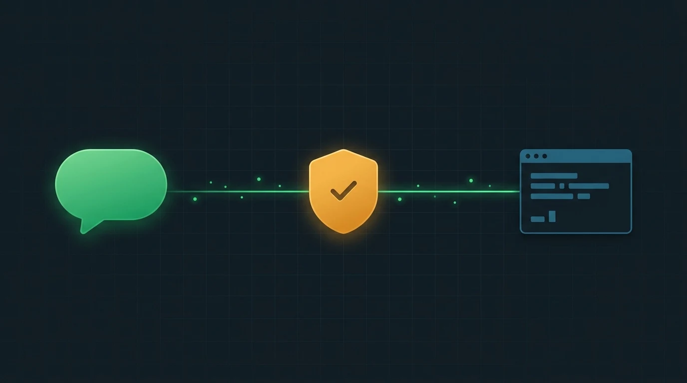

# WhatsApp para agentes de IA

[English](README.md) | **Português**



Conecta o seu WhatsApp a agentes de IA por um servidor MCP. Funciona com Claude Code, OpenBot, Codex, OpenCode, OpenClaw e qualquer outro agente que fale MCP. O agente lê e busca conversas, transcreve áudios e sugere respostas no seu jeito de escrever. **O envio vem desligado e nada sai sem a sua confirmação explícita**: o servidor começa em modo somente leitura, e se você liberar o envio, cada mensagem precisa da sua confirmação.

| Seu agente | Como usar | O que vem junto |
|---|---|---|
| **Claude Code** | plugin | skills, comandos, hook que liga a bridge e o guarda de envio |
| **OpenBot** | servidor MCP em containers ([guia](docs/openbot.md)) | skills; a bridge fica fora do alcance do agente |
| **Codex, OpenCode, OpenClaw** | servidor MCP por stdio ([guia](docs/agentes.md)) | skills |
| **Outro agente com MCP** | servidor MCP por stdio ou HTTP | skills |

O projeto reúne tudo o que é preciso:

- **Servidor MCP** em Python, com 13 ferramentas (buscar contatos, ler mensagens, enviar, baixar mídia, transcrever áudio).
- **Bridge** em Go que conecta ao WhatsApp como um aparelho a mais (multidispositivo).
- **Seis skills**, no formato padrão de skill, para qualquer agente que as aceite: uma que **instala e configura tudo por você** (veja a seção abaixo) e cinco que ensinam o agente a usar o MCP, fazer a triagem das conversas, lembrar o jeito de falar de cada contato, escrever com linguagem humana e dividir respostas em várias mensagens.
- **Comandos** para o Claude Code (`/whatsapp:status`, `/whatsapp:pendentes`, `/whatsapp:responder`, `/whatsapp:resumo`, `/whatsapp:loop`, `/whatsapp:modo`, `/whatsapp:atualizar`). Nos outros agentes, peça em linguagem natural.
- **Hooks do Claude Code**: um liga a bridge no início da sessão, outro é o guarda de envio. Nos outros agentes, o servidor MCP faz essa proteção sozinho (veja "Modos de envio").

> **Leia antes de usar.** A bridge usa a biblioteca `whatsmeow`, um cliente **não oficial** do WhatsApp. O uso pode ir contra os termos do WhatsApp e o seu número pode ser bloqueado. Use por sua conta e risco, com o seu próprio número, e respeite a privacidade de quem conversa com você. Este projeto não tem ligação com o WhatsApp nem com a Meta.

## Instalar com a ajuda de um agente

O jeito mais curto: cole este texto no seu agente (Claude Code, OpenBot, Codex, OpenCode, OpenClaw ou outro com terminal).


```
Instale o plugin de WhatsApp para mim. Clone https://github.com/armandonettox/whatsapp-plugin, leia o arquivo skills/instalar-whatsapp/SKILL.md e siga-o até o servidor funcionar. Pergunte antes de instalar qualquer programa, pare quando precisar que eu leia o QR no celular, deixe o envio de mensagens desligado e nunca mostre a senha da bridge.
```

O agente segue a skill [`instalar-whatsapp`](skills/instalar-whatsapp/SKILL.md): descobre o seu sistema e o agente que está usando, faz todas as perguntas em uma mensagem só, instala o que falta (com a sua permissão), baixa a bridge pronta (ou compila), registra o servidor MCP, confere que tudo funciona e entrega um resumo. A cada passo ele roda um diagnóstico (`skills/instalar-whatsapp/scripts/verificar_instalacao.py`) que só lê e mostra o que falta.

**O que continua sendo seu:**

- **Ler o QR no celular** (WhatsApp, Aparelhos conectados): só você consegue.
- **Autorizar** a instalação de programas (uv, Go, compilador, Podman).
- **Decidir** se o agente pode enviar mensagens. A instalação termina com o envio desligado (`read-only`).

**O que ele não faz:** enviar mensagem (nem de teste), mostrar a senha da bridge, ou mexer em serviços que já rodam sem pedir a sua confirmação.

Prefere instalar à mão? Veja a seção "Instalação" abaixo.

## Como funciona


1. O agente chama uma ferramenta do **servidor MCP**.
2. Para **ler**, o servidor consulta direto os bancos SQLite locais (`data/store`), que a bridge mantém atualizados.
3. Para **enviar** ou baixar mídia, o servidor chama a **bridge** por HTTP, só dentro do seu computador (`127.0.0.1:8081`).
4. A bridge fala com o WhatsApp pelo protocolo multidispositivo e grava o que chega e sai nos bancos.
5. Antes de qualquer envio, o **guarda** confere a sua última mensagem (veja abaixo).

## O guarda de envio (Claude Code)


O guarda é um hook do Claude Code que roda antes de `send_message`, `send_file` e `send_audio_message`. Ele lê a **sua última mensagem** na conversa e só libera o envio se for uma confirmação curta e direta.

| Libera | Bloqueia |
|---|---|
| sim, manda, pode, confirma, envia, beleza | não, mas, troca, espera, qualquer pergunta, frases longas |
| | "sim, mas troca o oi" (confirmação com edição) |

Quando bloqueia, o agente mostra o texto exato e o destinatário e pede a confirmação de novo. O guarda **falha fechado**: se não conseguir verificar (sem histórico da conversa ou sem Python), ele bloqueia o envio.

**Limite importante:** o guarda é um recurso do Claude Code. Em outros agentes (OpenBot, OpenClaw, Codex, OpenCode e similares) ele **não existe**, mas o próprio servidor se protege: por padrão ele é **somente leitura** e as ferramentas de envio nem aparecem para o agente. Veja os [modos de envio](#modos-de-envio).

## Modos de envio


A variável `WHATSAPP_SEND_MODE` decide o que o servidor MCP permite. Sem ela, vale o modo mais seguro.

| Modo | O que acontece | Quando usar |
|---|---|---|
| `read-only` (padrão) | As ferramentas de envio **nem aparecem** para o agente. Ele só lê, busca, baixa mídia e transcreve. | Qualquer agente, sem configurar nada. |
| `two-step` | As ferramentas de envio só **guardam um rascunho**. Quem envia é você, no terminal, com `confirm.py`. | OpenBot, OpenClaw, Codex, OpenCode e outros agentes sem o guarda. |
| `hook` | As ferramentas **enviam direto**. | Só no Claude Code, onde o guarda confirma cada envio. O plugin liga esse modo sozinho. |

Valor desconhecido, com erro de digitação ou vazio cai em `read-only`.

### Como funciona o `two-step`

1. O agente chama `send_message`. Nada é enviado: o servidor guarda um rascunho e devolve um identificador e o comando para você.
2. O agente mostra o texto e o destinatário e pede que você rode o comando.
3. Você abre **um terminal seu**, na pasta `server/`, e confere o rascunho:

```
python confirm.py list             # rascunhos esperando
python confirm.py show a1b2c3d4    # texto inteiro e destinatário
python confirm.py send a1b2c3d4    # pergunta e só envia se você digitar "enviar"
python confirm.py discard a1b2c3d4
```

4. O agente pode perguntar o resultado com `check_pending_send` (`pending`, `sent`, `discarded` ou `expired`). Ele nunca recebe o texto de volta.

O `confirm.py send` recusa rodar sem um terminal interativo e não tem opção para pular a pergunta. Os rascunhos expiram em 30 minutos e há no máximo 20 esperando.

**Limite honesto:** um agente que tenha um terminal próprio e saiba simular um teclado poderia, em teoria, rodar o `confirm.py` sozinho. Se o seu agente tem ferramenta de shell, mantenha o `read-only` ou use as permissões do agente para impedir comandos que chamem o `confirm.py`.

### Agentes com terminal (OpenBot): isolamento com containers


Um agente que tem terminal e roda sem confirmação poderia chamar a API da bridge direto e ignorar os modos de envio. Por isso, para o OpenBot e agentes parecidos, a bridge e o servidor MCP rodam em containers: a bridge fica numa rede que o agente não alcança, a API dela exige uma senha que só os dois containers conhecem, e o agente só chega ao servidor MCP. O passo a passo, na VPS ou no computador, está em [docs/openbot.md](docs/openbot.md).

## Privacidade e segurança

- As mensagens e os bancos ficam no seu computador. **O que o agente lê é enviado ao modelo que você usa** (o provedor do seu agente). Não use com conversas que não possam passar por ele.
- A API da bridge escuta só em `127.0.0.1` por padrão e **permite enviar mensagens pelo seu número**. Ela aceita uma senha (`WHATSAPP_BRIDGE_TOKEN`), que é obrigatória em containers. Um agente com terminal no mesmo computador alcança essa porta: para esse caso, use o isolamento com containers.
- A pasta `data/` guarda as mensagens e a sessão do WhatsApp. Quem lê essa pasta controla a sua conta. Ela está no `.gitignore`: nunca a envie para o git, nuvem ou backup compartilhado.
- As notas por contato (`data/notas`) e os rascunhos do loop (`data/rascunhos`) são dados pessoais de outras pessoas e também ficam fora do git.

## Requisitos

| Item | Para quê |
|---|---|
| Um agente com suporte a MCP | Claude Code, OpenBot, Codex, OpenCode, OpenClaw ou outro |
| [`uv`](https://docs.astral.sh/uv/) | rodar o servidor MCP |
| [Go](https://go.dev/dl/) 1.25 ou superior e compilador C (`gcc`) | só se for compilar a bridge (usa SQLite via CGO; no Windows, MSYS2/MinGW). A release traz a bridge pronta, então a maioria das pessoas dispensa os dois |
| `ffmpeg` e extra `audio` | só se for transcrever áudios (opcional) |
| Um celular com WhatsApp | para ler o QR de conexão |

Testado no Windows 11. Em Linux e macOS o código é o mesmo (a integração contínua roda os testes nos dois), mas o hook do Claude Code que liga a bridge ainda não foi testado lá.

## Instalação

**1. Baixe o projeto**

```
git clone https://github.com/armandonettox/whatsapp-plugin.git
```

**2. Obtenha a bridge.** Baixe a pronta para o seu sistema (Windows, Linux ou macOS, amd64 ou arm64). O script confere o SHA-256 publicado antes de gravar o arquivo:

```
cd whatsapp-plugin
python skills/instalar-whatsapp/scripts/baixar_bridge.py
```

Sem bridge pronta para o seu sistema, ou sem rede? Compile (precisa de Go e compilador C):

```
cd whatsapp-plugin/bridge
go build -o main.exe .            # Windows
go build -o whatsapp-bridge .     # Linux e macOS
```

**3. Conecte o WhatsApp (só na primeira vez).** Rode a bridge **em um terminal** para ver o QR:

```
./main.exe                        # ou ./whatsapp-bridge
```

No celular: WhatsApp, Aparelhos conectados, Conectar um aparelho, e leia o QR do terminal. Quando a bridge mostrar que conectou, ela começa a baixar o histórico. Pode deixá-la rodando ou fechar com Ctrl+C. Nas próximas vezes, no Claude Code o hook a liga sozinho; nos outros agentes, inicie-a à mão.

**4. Conecte ao seu agente**

**Claude Code**, direto da pasta, para testar:

```
claude --plugin-dir /caminho/para/whatsapp-plugin
```

Ou pelo catálogo do repositório:

```
/plugin marketplace add armandonettox/whatsapp-plugin
/plugin install whatsapp@whatsapp-plugin
```

**Outros agentes** (OpenBot, Codex, OpenCode, OpenClaw e demais): cadastre o servidor MCP seguindo o [guia por agente](docs/agentes.md). O comando do servidor é `uv --directory /caminho/para/whatsapp-plugin/server run main.py`. Para o OpenBot, use os containers do [guia do OpenBot](docs/openbot.md).

**5. Confira.** Abra o seu agente e peça: "liste meus últimos 5 chats do WhatsApp". Se a lista aparecer, está funcionando.

## Uso

**Ferramentas do MCP**

| Ferramenta | O que faz |
|---|---|
| `search_contacts` | busca contatos por nome ou número |
| `list_chats`, `get_chat`, `get_contact_chats` | lista conversas e mostra os dados de uma |
| `get_direct_chat_by_contact` | acha a conversa direta com um número |
| `list_messages`, `get_message_context` | lê mensagens, com filtros e contexto ao redor |
| `get_last_interaction` | última interação com um contato |
| `send_message`, `send_file`, `send_audio_message` | enviam ou guardam rascunho, conforme o [modo de envio](#modos-de-envio) (no Claude Code, passam pelo guarda) |
| `download_media` | baixa fotos, documentos e áudios |
| `transcribe_audio` | transcreve um áudio com o Whisper local (opcional) |

**Skills e comandos.** Peça, por exemplo: "veja quem me mandou mensagem e preciso responder", ou use `/whatsapp:pendentes` e `/whatsapp:responder <contato>`. A triagem lista as conversas com mensagem pendente, as notas guardam o jeito de falar de cada contato, a skill de escrita ajuda a soar humano, a de partes divide a resposta em várias mensagens, e **nada é enviado sem a sua confirmação**. Os scripts em `skills/triagem-whatsapp/scripts/` (`listar_pendentes.py`, `buscar_contato.py`, `resumo_contato.py` e outros) fazem as consultas aos bancos em modo somente leitura.

**Transcrição de áudio (opcional).** Rode `uv sync --extra audio` na pasta `server/` e tenha o `ffmpeg` no PATH. O idioma padrão é o português; mude com `WHATSAPP_AUDIO_LANGUAGE` (por exemplo `en`).

**Variáveis de ambiente**

| Variável | Padrão | Para quê |
|---|---|---|
| `WHATSAPP_API_BASE_URL` | `http://localhost:8081/api` | endereço da bridge usado pelo servidor |
| `WHATSAPP_BRIDGE_DIR` | `bridge/` do plugin | pasta da bridge usada pelo hook de início |
| `WHATSAPP_BRIDGE_PORT` | `8081` | porta usada pelos scripts da skill |
| `WHATSAPP_STORE_DIR` | `data/store` | onde estão os bancos |
| `WHATSAPP_NOTES_DIR` | `data/notas` do plugin | onde ficam as notas por contato |
| `WHATSAPP_DRAFTS_DIR` | `data/rascunhos` do plugin | onde o modo loop salva as respostas sugeridas |
| `WHISPER_MODELO` | `small` | modelo do Whisper: `tiny`, `base`, `small`, `medium` ou `large` |
| `WHATSAPP_BRIDGE_TOKEN` | vazio | senha da API da bridge. Quando definida, a bridge exige `Authorization: Bearer <senha>` e o servidor envia o mesmo valor. Obrigatória em containers e quando o agente tem terminal |
| `WHATSAPP_BRIDGE_ADDR` | `127.0.0.1` | endereço em que a bridge escuta. Fora do loopback, a bridge só abre com a senha definida |
| `WHATSAPP_MCP_TRANSPORT` | `stdio` | `stdio` ou `streamable-http` (para agentes que não iniciam o servidor por stdio) |
| `WHATSAPP_MCP_HOST` | `127.0.0.1` | endereço do servidor no modo HTTP. Fora do loopback exige `WHATSAPP_MCP_ALLOWED_HOSTS` |
| `WHATSAPP_MCP_PORT` | `8765` | porta do servidor no modo HTTP |
| `WHATSAPP_MCP_ALLOWED_HOSTS` | vazio | nomes aceitos no cabeçalho `Host` no modo HTTP, separados por vírgula (por exemplo `whatsapp-mcp:8765`) |
| `WHATSAPP_CONFIRM_COMMAND` | `python .../confirm.py` | começo do comando que o servidor mostra para confirmar um rascunho (em container, `podman exec -it whatsapp-mcp python confirm.py`) |
| `WHATSAPP_AUDIO_LANGUAGE` | `pt` | idioma dos áudios |
| `WHATSAPP_SEND_MODE` | `read-only` | `read-only`, `two-step` ou `hook` (veja os modos de envio) |
| `WHATSAPP_PENDING_DIR` | `data/pending/` do plugin | onde ficam os rascunhos do `two-step` |
| `WHATSAPP_PENDING_TTL_MINUTES` | `30` | validade de um rascunho do `two-step`, em minutos |

## Usar em outros agentes

O servidor é um MCP comum, por stdio ou por HTTP. Em outro agente, cadastre este comando:

```
uv --directory /caminho/para/whatsapp-plugin/server run main.py
```

Sem configurar mais nada, o agente fica em modo **somente leitura**: lê e busca, mas não vê nenhuma ferramenta de envio. Para permitir envio com confirmação sua, passe `WHATSAPP_SEND_MODE=two-step` ao servidor (veja os [modos de envio](#modos-de-envio)). **O guarda não vale fora do Claude Code**, e o modo `hook` só deve ser usado lá. Mantenha a bridge rodando no mesmo computador do servidor. Para usar as skills fora do plugin, copie as pastas de `skills/`: cada uma funciona sozinha, e os scripts leem as pastas indicadas pelas variáveis de ambiente.

O guia [docs/agentes.md](docs/agentes.md) traz o cadastro do servidor e a limitação de ferramentas em OpenCode, Codex, OpenClaw e OpenBot, só com o que a documentação de cada um confirma, e diz o que não deu para confirmar.

## Documentação

- [Guia de uso](docs/guia-de-uso.md): instalar, conectar, usar, atualizar e remover.
- [Guia por agente](docs/agentes.md): OpenCode, Codex, OpenClaw e OpenBot.
- [Usar com o OpenBot](docs/openbot.md): a bridge em containers, na VPS ou no notebook, sem dar ao agente acesso direto à conta.
- [Solução de problemas](docs/solucao-de-problemas.md): sintomas e correções.
- [Histórico de versões](CHANGELOG.md).

## Estado do projeto

Versão `0.1.2`.

**Testado:** os testes automáticos rodam em Linux e Windows a cada envio (guarda de envio, modos de envio, servidor HTTP, senha da bridge, arquivos de container, skills e verificador de privacidade); o `docker compose config` aceita o arquivo Compose; os Quadlets passaram na simulação do gerador do Podman 4.9; e um agente seguiu o prompt de instalação, em modo ensaio, até o passo do QR.

**Ainda não testado:** o download da bridge pronta (funciona assim que uma release trouxer os binários gerados pelo fluxo de release); a construção das imagens de container e o uso do OpenBot com elas (o script da VPS foi testado com substitutos de `podman` e `systemctl`); o cadastro do servidor por URL no OpenBot (a tela de cadastro não está documentada); o fluxo completo depois da leitura do QR com esta versão; os comandos de instalação de `winget` e `brew` da skill.

## Créditos e licença

- Baseado no [whatsapp-mcp](https://github.com/lharries/whatsapp-mcp) de Luke Harries (licença MIT). O texto da licença original está em `LICENSE` e o aviso em `NOTICE`.
- A bridge usa a biblioteca [whatsmeow](https://github.com/tulir/whatsmeow) (licença MPL-2.0), sem alterações no código dela.
- Servidor, skill, scripts, hooks e este README: licença MIT.
